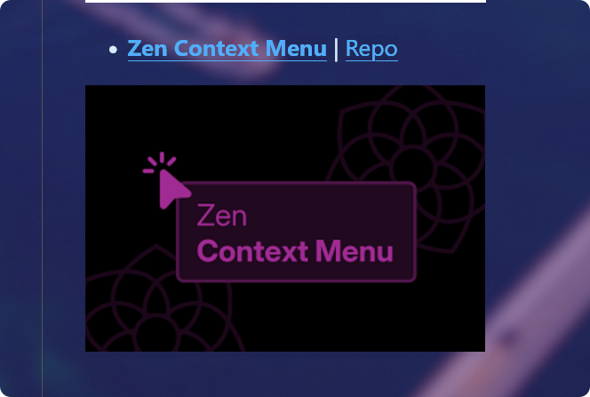

# Zen Context Menu Fix

> 自行维护与修复版本的 **Zen Context Menu**（基于原作者 [KiKaraage](https://github.com/KiKaraage/ZenMods) 的 Zen 浏览器右键菜单精简 Mod，原 Mod ID: `81fcd6b3-f014-4796-988f-6c3cb3874db8`）。

## 📌 项目背景

Zen 浏览器随着上游 Firefox 升级以及自身功能迭代（例如新增 Glance 快速预览、分屏标签等），原有主题商店中的 Zen Context Menu 已停止维护，部分右键菜单项的选择器失效或样式冲突。

本仓库保留了该 Mod 的完整代码结构，用于个人长期更新、修复失效选择器并适配 Zen 新版本。

---

## 📂 文件结构说明

| 文件 | 说明 |
| :--- | :--- |
| **`chrome.css`** | 核心样式表。包含标签页右键菜单的人体工程学重排、各类冗余菜单项的隐藏规则、图标隐藏与间距修复等。 |
| **`preferences.json`** | Mod 的配置项定义文件。定义在 Zen / Sine 设置面板中可勾选的开关项。 |
| **`theme.json`** | Mod 元数据定义（ID、名称、版本、作者等）。 |
| **`image.png`** | 预览封面图片。 |

---

## 🛠️ 安装与使用方法

### 方式一：在 Sine / 本地 Zen Mods 中加载（推荐）
如果你在使用 **Sine** 扩展或 Zen 浏览器本地 Mod 机制：

1. 在 Zen 配置目录下的 `chrome/sine-mods/`（或 `chrome/zen-themes/`）中，确保存在本 Mod 文件夹（或创建符号链接 Symlink 指向本目录）。
2. 在 `mods.json`（或 `zen-themes.json`）中将该 Mod 的 `"no-updates"` 设为 `true`，防止商店自动覆盖本地修改。
3. 进入浏览器设置或 Sine 面板重新切换启用一次即可。

### 方式二：直接作为 `userChrome.css` 使用
如果你更喜欢直接掌控样式：
1. 打开 Zen 配置文件夹（可在地址栏访问 `about:support` -> 查看“配置文件夹”）。
2. 打开 `chrome/userChrome.css`（若无则新建）。
3. 使用 `@import` 引入本仓库的 `chrome.css`，或者直接将所需样式复制进 `userChrome.css`。
4. 确保 `about:config` 中的 `toolkit.legacyUserProfileCustomizations.stylesheets` 为 `true`。
5. 重启浏览器。

---

## 🔍 排查与修复指南（当 Zen 更新导致菜单项失效时）

Firefox 与 Zen 经常调整右键菜单的 DOM 结构与 ID。遇到菜单项无法隐藏或错位时，可通过以下步骤抓取最新元素 ID：

### 1. 开启开发者工具权限
1. 按 `F12` 打开开发者工具，点击右上角设置图标（⚙️）。
2. 在设置中勾选：
   - **“启用浏览器 chrome 和附加组件调试工具箱” (Enable browser chrome and add-on debugging toolboxes)**
   - **“启用远程调试” (Enable remote debugging)**

### 2. 锁定右键菜单并检查元素
1. 按全局快捷键 `Ctrl + Shift + Alt + I`（macOS 上为 `Cmd + Opt + Shift + I`）打开 **Browser Toolbox**。
2. 在弹出的权限请求中点击“允许”。
3. 在 Browser Toolbox 窗口右上角，点击四个小方块重叠的气泡图标，勾选 **“禁用弹出菜单自动隐藏” (Disable popup auto-hide)**。
4. 回到 Zen 浏览器主窗口右击呼出菜单（此时菜单不会消失）。
5. 使用工具箱左上角的光标指针点击该菜单项，即可查到其最新 `id` 或属性选择器。
6. 在 `chrome.css` 对应的 `@media -moz-pref(...)` 区块中更新选择器即可。

---

## 📝 维护日志

- **v3.2_fix / Initial Repository Setup**:
  - 建立独立维护仓库 `Zen Context Menu Fix`。
  - 整理 `chrome.css`、`preferences.json`、`theme.json` 及封面资源。
