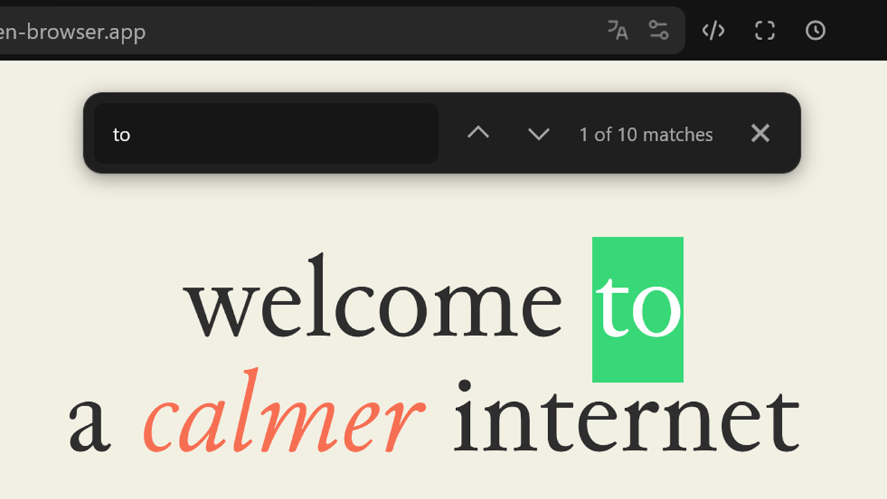

# Floating Findbar Fix

> 针对 **Zen 浏览器** 的居中悬浮搜索栏 Mod，带有展开与收起的平滑过渡动画（基于原作者 [qumeqa/floating-findbar](https://github.com/qumeqa/floating-findbar) 进行维护与修复）。



## ✨ 特性

- 居中悬浮于浏览器网页区域上方，不挤压网页内容与视口高度。
- 采用 `@starting-style` 与现代 CSS 过渡，提供丝滑优雅的展开与收起动效。
- 适配 Zen 主题风格的暗色/亮色毛玻璃背景与阴影层级。
- 隐藏不常用的冗余查找按钮，保持极简视觉。

## 📥 安装方法

在 Zen 浏览器的 **Sine Mods** 安装输入框中输入：
```text
Sostay/Zen-Mods/tree/main/mods/floating-findbar
```
点击 **Install** 即可。